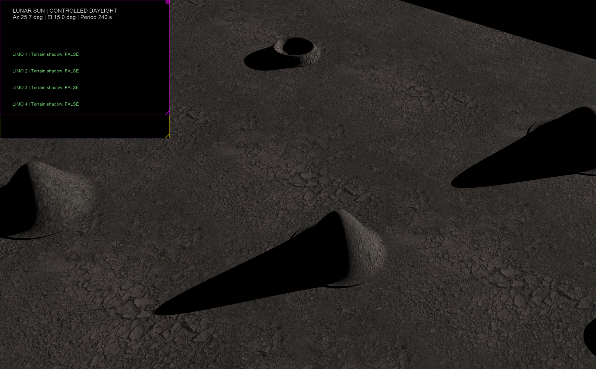

# 달 맵 ROS 통합 실행



언덕·크레이터의 그림자와 LIMO 4대의 지형 그림자 판정 상태를 표시한 Webots 실행 화면입니다.

기존 dev_gayeon 파일을 수정하지 않고 추가한 통합 패키지입니다. 맵 전용 moon_map_release와 달리 Webots ROS 드라이버·센서·TF·robot1 SLAM 및 Nav2·RViz를 함께 실행합니다.

- 달 지형·고도 15도 회전 태양·숨긴 경계벽·LIMO 4대.
- 네 대 모두 /robotN/scan, /robotN/odom 및 TF 제공. 카메라는 구독 시 발행합니다.
- robot1만 SLAM·Nav2를 수행하며 robot2~4는 시작 위치에서 대기합니다.
- 가연 브랜치의 live_mapping 및 launch 구성을 기반으로 별도 환경 파일과 네 번째 로봇을 추가했습니다. 기존 multirobot_sim의 드라이버·센서·지도 격자 코드를 재사용합니다.
- 시작 위치는 로봇들 사이의 공통 좌표계를 맞추는 용도이며 사전 장애물 지도는 제공하지 않습니다.
- ROS 센서 모델에 맞추어 이 패키지의 카메라는 원래 수평·644×524 렌더/640×480 발행 구성입니다. 맵 전용 폴더의 하향·저해상도 카메라와 다릅니다.

저장소 루트에서:
```bash
source /opt/ros/jazzy/setup.bash
colcon build --base-paths ros_packages/multirobot_sim ros_packages/moon_mapping_demo --symlink-install
source install/setup.bash
ros2 launch moon_mapping_demo moon_mapping.launch.py
```

현재 노트북의 별도 검증 빌드 실행:
```bash
source /opt/ros/jazzy/setup.bash
source /home/willy/limo_jazzy_ws/integration_moon_runtime/install/setup.bash
export ROS_DOMAIN_ID=63
ros2 launch moon_mapping_demo moon_mapping.launch.py
```

RViz의 robot1용 2D Goal Pose로 가까운 관측 완료 흰색 공간을 지정하세요. 미관측 공간을 가로지르는 목표는 경로 생성에 실패할 수 있습니다. 움직이는 그림자 인식·회피, 자동 탐사·복귀, 4대 지도 병합 및 Pygame BT는 연결하지 않았습니다. 2D SLAM 지도는 높이 지도나 그림자 지도가 아닙니다.

검증: 4대 scan/odom 메시지, robot1 RGB 640×480 메시지, SLAM /map의 관측된 셀, Nav2 활성 로그 및 RViz 프로세스를 확인했습니다. 실제 로봇 적용 및 전 영역 탐사는 검증하지 않았습니다.

현재 물리 중력은 주행·SLAM 비교를 위해 9.81 m/s²로 설정했습니다. 달 저중력은 비활성화한 상태이며 언덕·크레이터의 경사 및 충돌 형상은 유지합니다.

## 지도 왜곡 진단
달 ROS 월드의 바퀴 접촉 조건을 원래 공장 월드와 동일하게 맞췄고 물리 시간 간격을 10ms로 조정했습니다. `scan_matching:=false`로 실행하면 스캔 정합과 루프 폐쇄 보정을 끈 오도메트리 기반 지도 누적을 비교할 수 있습니다. 기본값은 true입니다. false는 SLAM의 위치 드리프트 보정이 없는 진단 모드이며 완성된 SLAM 해결책이 아닙니다.

추가 진단 결과: RViz 변환 전 /robot1/map에서도 부채꼴 미관측 영역과 경계 흔적이 나타났습니다. 경계에서의 라이다 반사점은 실제 위치 기준 중앙 오차 약 4cm, 저속 회전 시 오도메트리 방위각은 실제 자세와 평균 약 0.23도 차이였습니다. 해당 수치는 제한된 진단 구간이며 전체 주행 정확도를 보장하지 않습니다.

SLAM 전용 scan_slam 입력은 실제 센서 범위 0.1~12m로 제한하고 센서의 0 미검출값을 infinity로 변환했습니다. 원본 scan과 기존 multirobot_sim 파일은 수정하지 않았습니다. 보정 후 짧은 회전 구간에서 지도-오도메트리 변환의 평면 보정량은 약 0.09m였지만, 부채꼴 미관측 영역은 남아 있습니다. 전 영역 지도 완성 및 긴 주행에서의 지도 안정화는 검증되지 않았으며, 문제 해결 완료로 간주하지 않습니다.


## 현재 맵 설정 (2026-11-20)

- 20×20m 평지, LIMO 4대, 언덕 3개(높이 약 1m), 크레이터 3개.
- 언덕·크레이터에 바닥과 같은 달 표면 텍스처 적용.
- 태양 고도 15°, 시뮬레이션 시간 240초에 방위각 한 바퀴 회전.
- 가장자리 벽은 주 화면에서 숨기며 충돌 및 센서 경계는 유지.
- 중력 9.81m/s². 실제 달 중력 설정이 아닙니다.
- 자동 탐사, 그림자 회피, 복귀, 실제 로봇 연결 및 좌표 축척은 아직 포함하지 않습니다.


## 지형 그림자 상태 표시

ROS 통합 실행 시 태양 컨트롤러가 언덕·크레이터 메시와 태양 방향을 이용하여 로봇 바닥 영역의 9개 지점을 검사합니다. 하나라도 가려지면 TRUE입니다. 0.5초의 시뮬레이션 시간 간격으로 계산하며, Webots의 LUNAR SUN 아래에 로봇별 상태를 표시합니다. 리모와 경계 벽은 차폐물 계산에서 제외하며 이동 제어에는 개입하지 않습니다. 샘플 사이의 작은 그림자까지 모두 보장하는 연속 면적 판정은 아닙니다.

- `/robot1/in_terrain_shadow` ~ `/robot4/in_terrain_shadow`: `std_msgs/msg/Bool`
- TRUE: 지형 그림자 안의 검사 지점이 있음. FALSE: 검사 지점이 모두 지형 그림자 밖임.
- 시뮬레이터 실제 지형·로봇 위치를 사용하는 검증용 정답입니다. 지도 없는 센서 기반 추정 기능이 아닙니다.
- ROS 실행기는 프로젝트 전용 Webots 설정으로 그림자 렌더링을 활성화하고 태양 컨트롤러를 외부 연결합니다.
- 초기 위치에서 네 토픽 수신 및 FALSE 상태, Nav2 활성화를 확인했습니다. 그림자 경계 전체에 대한 주행 검증은 별도입니다.

```bash
ros2 topic echo /robot1/in_terrain_shadow
```

단독 실행용 `moon_map_release`에는 ROS 토픽 및 로봇별 그림자 판정 표시가 없습니다. 위 기능은 `moon_mapping_demo`에 포함됩니다.


## 브랜치 호환 모듈

가연 브랜치의 지도 변환, 매핑용 드라이버·센서, 센서 준비 확인 코드를 이 패키지 내부에 포함합니다. 따라서 기존 `multirobot_sim`에 `map_grid`나 매핑용 heartbeat 선택 기능이 없는 브랜치에서도 실행할 수 있습니다. 기존 `multirobot_sim` 파일은 덮어쓰지 않으며 달 맵 URDF만 내부 드라이버를 사용합니다. robot1만 매핑 모드에서 BT heartbeat 없이 Nav2 명령을 수행하고 나머지는 대기합니다.
