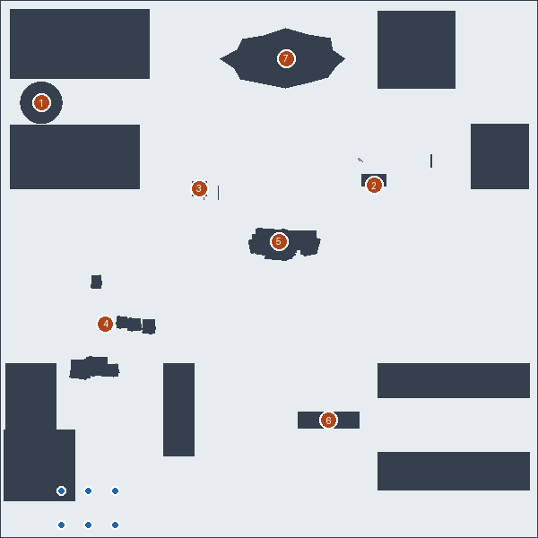

# 도시 재난 대응 Webots 맵

30 × 30m 도시 블록의 교차로와 골목을 배경으로 다중 로봇의 임무 할당과 재할당을 시연하기 위한 맵입니다. 시작 위치와 충전 위치를 겸하는 구역에 리모 6대가 배치되어 있습니다.



위 그림은 주행용 점유 지도를 기반으로 제작했습니다. 파란 점은 로봇 시작 위치이며, 주황색 번호는 아래 표의 재난 지점입니다.

## Webots에서 열기

Webots R2025a에서 [worlds/urban_disaster.wbt](worlds/urban_disaster.wbt)를 엽니다. 터미널에서는 이 README가 있는 폴더에서 다음 명령을 실행합니다.

```bash
webots --mode=pause worlds/urban_disaster.wbt
```

맵을 다른 PC로 옮길 때는 모델과 텍스처의 상대 경로가 유지되도록 `urban_disaster_30m` 폴더 전체를 복사합니다.

## 재난 시나리오

| 번호 | 임무 | 투입 대수 | 기준 시간 |
| --- | --- | --- | --- |
| 1 | 화재 진압 | 2–4대 | 30초 |
| 2 | 배전함 복구 | 2–3대 | 20초 |
| 3 | 소화전 수리 | 2–4대 | 20초 |
| 4 | 작은 잔해 제거 | 1–3대 | 10초 |
| 5 | 큰 잔해 제거 | 4–6대 | 50초 |
| 6 | 가로수 제거 | 3–5대 | 30초 |
| 7 | 위험구역 출입 통제 | 1–2대 | 10초 |

[시나리오 설정](scenario.json)에는 재난 좌표, 로봇 시작 위치, 임무별 접근 위치가 정의되어 있습니다. [주행용 정적 지도](maps/disaster_static.yaml)의 해상도는 0.05m/셀입니다.

실제 리모와 가상 리모를 함께 실행하려면 이 도시 월드와 주행용 지도를 하이브리드 실행 설정에 연결하고, 실제 리모의 기준 좌표를 맵의 시작 위치에 맞춰야 합니다.
